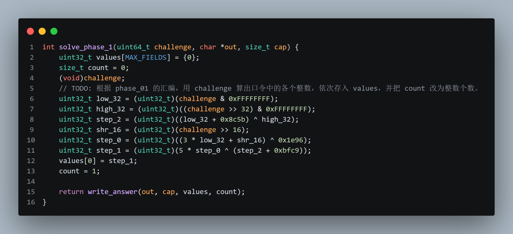
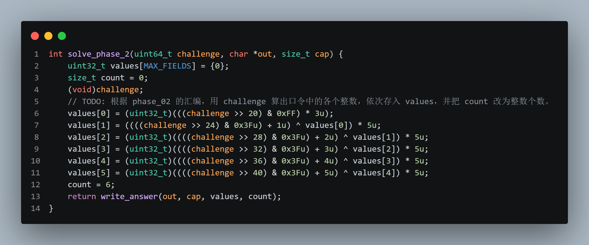
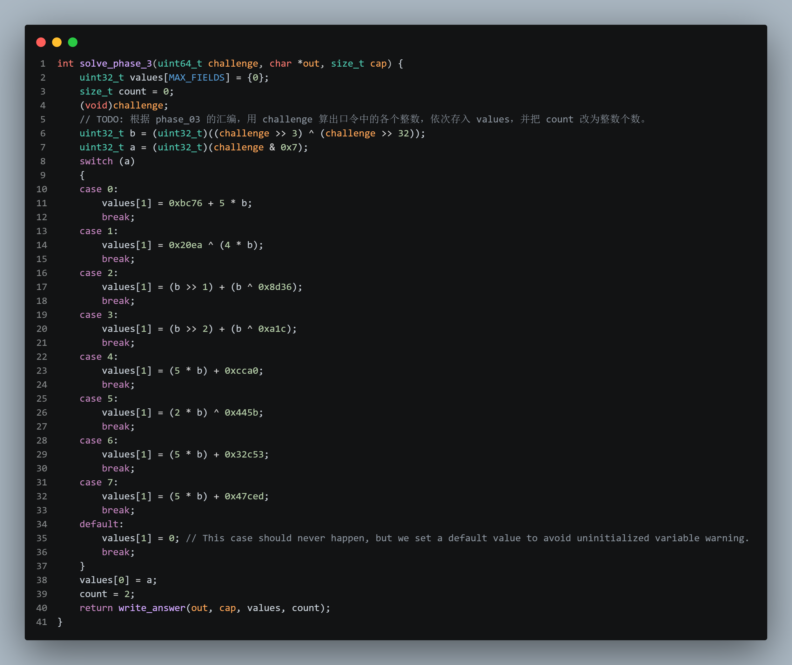
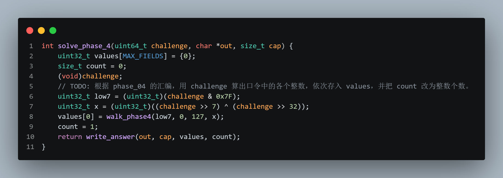
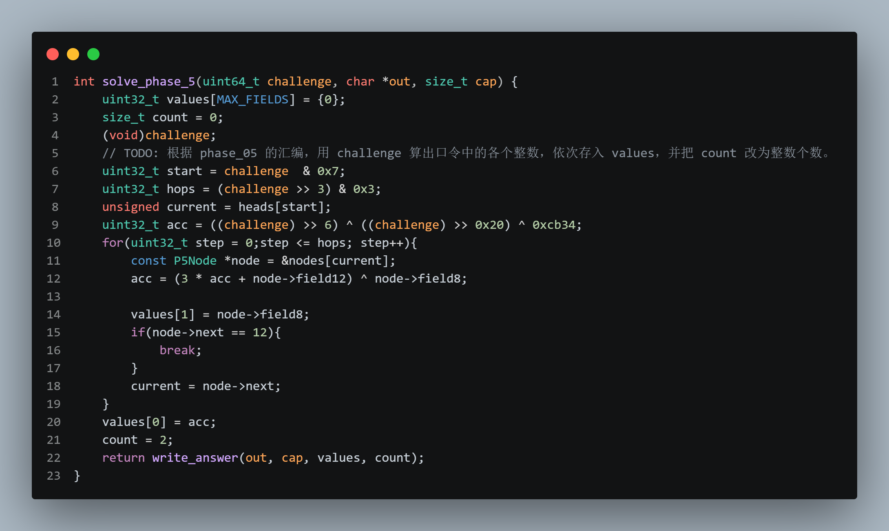
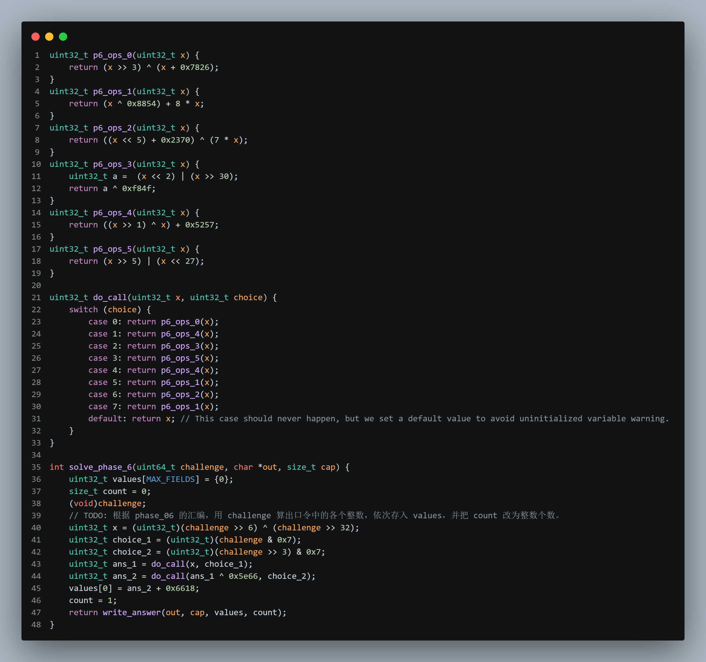
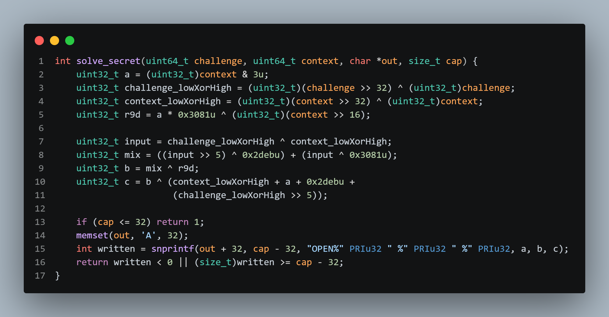
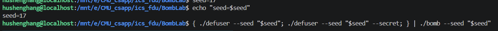
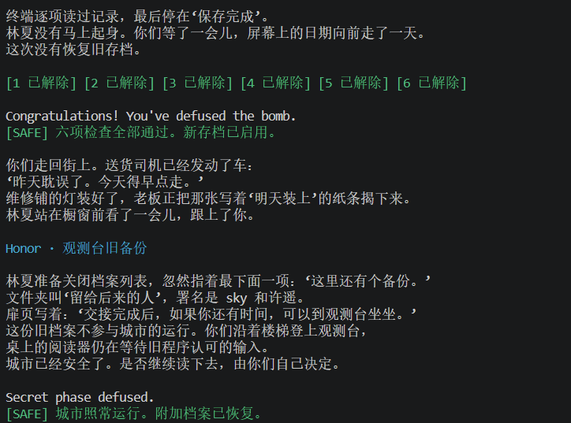

# BombLab 实验报告

## 1. 实验方法与输入输出

本实验要求在 `defuser.c` 中根据每关的 64 位 `challenge` 生成一行口令，交给个人 `bomb` 检查。Honor 还使用由前六行答案生成的 `context`。我先用 `objdump -d -M intel bomb` 查看函数入口和辅助函数，再结合 GDB 查看跳转表、链表节点及函数指针表，最后把判断条件还原成 C 运算。编译与验证使用 `make`、`public_test.py` 和个人 `bomb`。

阅读汇编时采用 x86-64 System V 调用约定：整数或指针参数依次放在 `rdi`、`rsi`、`rdx`、`rcx`、`r8`、`r9`，返回值通常在 `rax/eax`。本报告把低 32 位的运算按 `uint32_t` 理解：溢出时只保留低 32 位。下文的 `^` 表示按位异或，`>>` 表示无符号右移。

## 2. 各关分析

### 2.1 Phase 1：函数调用与参数传递

主函数先要求一项无符号整数。`sscanf` 把它写到栈上；随后 `p1_compute` 的返回值在 `eax`，与该整数比较：

```asm
40209d: mov  esi,0x1
4020aa: call valid_u32_fields
4020db: call p1_compute
4020e0: cmp  DWORD PTR [rbp-0x14],eax
```

在 `p1_compute` 中，64 位 `challenge` 被拆出低 32 位 `lo`、高 32 位 `hi`，另有右移 16 位后的低 32 位。它按 `p1_step2 → p1_step0 → p1_step1` 的顺序调用；前一次结果通过寄存器传给后一次。`lea eax,[rdi+rdi*2]` 是乘 3，`lea eax,[rdi+rdi*4]` 是乘 5。由此得到：

```text
s2 = (lo + 0x8c5b) ^ hi
s0 = (3*lo + (uint32_t)(challenge>>16)) ^ 0x1e96
answer = (5*s0) ^ (s2 + 0xbfc9)
```

因此求解器输出一个数，即 `answer`，并按 32 位无符号整数处理每步结果。



### 2.2 Phase 2：循环与数组

主函数传给 `valid_u32_fields` 的字段数是 6，`sscanf` 返回值也必须为 6，说明口令由六个数构成。第一项独立计算；后续项从栈上的连续数组读取：

```asm
4020fd: mov  esi,0x6
402155: cmp  eax,0x6
402160: shr  rax,0x14
402167: lea  eax,[rax+rax*2]
402185: mov  esi,DWORD PTR [rbp+rdx*4-0x40]
402189: lea  eax,[rax+rax*4]
402197: cmp  rdx,0x6
```

`shr rax,0x14` 后取低 8 位，再乘 3，形成 `v[0]`。循环中的移位量从 24 开始，每轮增加 4；取 6 位、加当前下标、与上一项异或，最后用 `lea` 乘 5。因此：

```text
v[0] = 3 * ((challenge >> 20) & 0xff)
v[i] = 5 * ( (((challenge >> (20+4*i)) & 0x3f) + i) ^ v[i-1] ), i=1..5
```

这里的括号很重要：顺序是先加 `i`，再异或 `v[i-1]`，最后乘 5。输出 `v[0]` 到 `v[5]` 六个数。



### 2.3 Phase 3：跳转表

主函数要求两个数。第一个数 `a` 与 `challenge & 7` 比较；第二个数与 `p3_dispatch` 返回值比较。调用分发函数前，程序还形成 `b=(uint32_t)((challenge>>3)^(challenge>>32))`。

```asm
402301: and  edi,0x7
402304: cmp  DWORD PTR [rbp-0x18],edi
402317: xor  esi,eax
402319: call p3_dispatch
40225d: jmp  QWORD PTR [rax*8+0x405820]
```

`rax*8` 说明每个表项是 8 字节地址，表里存的是要执行的代码位置，而不是整数答案。逐项读取表，再跟进目标处的跳转，得到以下对应关系。函数名的编号与输入下标并不一致。

| `a` | 跳到的计算分支 | 第二个数 |
| --- | --- | --- |
| 0 | `p3_case_4` | `5*b + 0xbc76` |
| 1 | `p3_case_0` | `(4*b) ^ 0x20ea` |
| 2 | `p3_case_5` | `(b>>1) + (b^0x8d36)` |
| 3 | `p3_case_3` | `(b>>2) + (b^0x0a1c)` |
| 4 | `p3_case_1` | `5*b + 0xcca0` |
| 5 | `p3_case_7` | `(2*b) ^ 0x445b` |
| 6 | `p3_case_2` | `5*b + 0x32c53` |
| 7 | `p3_case_6` | `5*b + 0x47ced` |

求解器先输出 `a`，再按表中选中的分支输出第二个数。



### 2.4 Phase 4：递归二分

主函数从 `challenge` 提取 `target=challenge&0x7f` 和 `salt=(uint32_t)((challenge>>7)^(challenge>>32))`，调用 `p4_walk(target,0,127,salt)`。辅助函数中的中点计算是：

```asm
402336: mov  edi,edx
402338: sub  edi,esi
40233a: shr  edi,1
40233c: add  edi,esi
40233e: cmp  edi,eax
```

因此 `mid=low+(high-low)/2`。命中时 `lea eax,[rdi+0x54]; xor eax,ecx` 返回 `(mid+0x54)^salt`。未命中时递归搜索相应半区间，递归返回后 `lea eax,[rax+rax*2]` 乘 3，再与本层保存的 `mid+salt` 及分支常量异或：

```text
walk(target,low,high,salt):
  mid = low + (high-low)/2
  target == mid: (mid+0x54) ^ salt
  target >  mid: (3*walk(target,mid+1,high,salt)) ^ (mid+salt) ^ 0x9
  target <  mid: (3*walk(target,low,mid-1,salt)) ^ (mid+salt) ^ 0x5
```

以公开列表外的 seed 17 为例，本关 `challenge=0x046b1664f61a205e`，得到 `target=94`、`salt=0xcd872224`。中点依次为 `63 → 95 → 79 → 87 → 91 → 93 → 94`；从命中处向上逐层返回，最终输出 `2737492756`。这也说明不能只求出目标位置，还要累计回溯时的运算。



### 2.5 Phase 5：结构体与链表遍历

主函数要求两个数，并调用 `p5_traverse(challenge,&field)`；第一个输入与返回值比较，第二个输入与写回的 `field` 比较。遍历函数先用低 3 位选取起始节点：

```asm
40242d: and  eax,0x7
402434: mov  rdx,QWORD PTR [rax*8+0x405b60]
402449: mov  esi,DWORD PTR [rdx+0x8]
402456: add  eax,DWORD PTR [rdx+0xc]
402468: mov  rdx,QWORD PTR [rdx]
```

`[rdx]` 读出下一节点的**数据地址**；`[rdx+8]` 和 `[rdx+12]` 是当前节点的两个 32 位字段。这是链表指针遍历，不是跳转表。节点布局可记为 `next(8 字节), field8(4 字节), field12(4 字节)`。起点表有八项，实际链表节点数据记在 `defuser.c` 的 `heads`、`nodes` 中。

初始累计值是 `(uint32_t)((challenge>>6)^(challenge>>32)^0xcb34)`。起始节点必须处理，然后再沿 `next` 走 `(challenge>>3)&3` 步。每处理一个节点都计算：

```text
acc = (3*acc + node.field12) ^ node.field8
field = node.field8
```

最后输出 `acc` 和最后访问节点的 `field8`。例如 seed 17 时，本关 `challenge=0x14db9121e4c732ea`，起点下标为 2，还需沿链表走 1 步。



### 2.6 Phase 6：函数指针表与间接调用

`p6_dispatch` 先算出 `x=(uint32_t)((challenge>>6)^(challenge>>32))`，再从地址 `0x405e00` 的函数指针表中连续取两次函数地址：

```asm
402590: and  ebx,0x38
402593: and  eax,0x7
402596: call QWORD PTR [rax*8+0x405e00]
40259d: xor  eax,0x5e66
4025a4: call QWORD PTR [rbx+0x405e00]
4025af: add  eax,0x6618
```

第一次的下标是 `challenge&7`；第二次的 `challenge&0x38` 已经是 0、8、…、56 的**字节偏移**，除以 8 才是下标 `(challenge>>3)&7`，因此不会越过八项表。表项有重复地址；按实际表内容得到下标 0～7 对应的函数为 `op0, op4, op3, op5, op4, op1, op2, op1`。其中 `rol eax,2` 和 `ror eax,5` 是 32 位循环移位，不能只保留普通移位的一侧。

```text
y = ops[challenge&7](x)
z = ops[(challenge>>3)&7](y^0x5e66)
answer = z+0x6618
```

求解器只输出 `answer`。seed 17 的两个选择下标分别为 4 和 0。



### 2.7 Honor：字符串布局、栈与三字段校验

`secret_gate` 先检查字符串长度，再把输入逐字节复制到栈上。长度判断为 `strlen(input)-0x24 <= 0x7f`（无符号比较），所以允许 36～163 字节。栈缓冲区从 `[rbp-0xd0]` 开始，偏移 32 的四个字节位于 `[rbp-0xb0]`，偏移 36 的文本从 `[rbp-0xac]` 开始：

```asm
402761: sub  rax,0x24
402765: cmp  rax,0x7f
402786: call secret_copy
40278b: cmp  DWORD PTR [rbp-0xb0],0x4e45504f
40279d: lea  rdi,[rbp-0xac]
4027a4: call secret_phase
```

四字节比较值按小端序对应文本 `OPEN`。`secret_copy` 中 `movzx edx,BYTE PTR [rsi+rax]`、`mov BYTE PTR [rdi+rax],dl` 每轮复制一个字节，直到复制了 `\0`。因此输入布局是 32 字节填充、`OPEN`、三个十进制数。

`secret_phase` 中的 `r12` 保存 Honor 的 `challenge`，`r13` 保存 `context`。`context` 由 `transcript_context` 对前六关答案计算，不是固定常量。函数用 `valid_u32_fields(...,3)` 和 `sscanf` 读出三个数 `a,b,c`，再逐项比较。第一个比较是 `a=(uint32_t)context&3`。后续移位和异或可以分成两个“高 32 位与低 32 位异或”的值，避免逐条追踪反复复用的寄存器：

```text
u = (uint32_t)(challenge>>32) ^ (uint32_t)challenge
v = (uint32_t)(context>>32) ^ (uint32_t)context
t = (a*0x3081) ^ (uint32_t)(context>>16)
mix(x) = ((x>>5)^0x2deb) + (x^0x3081)
b = mix(u^v) ^ t
c = b ^ (v+a+0x2deb+(u>>5))
```

这里 `imul r9d,ecx,0x3081` 对 `a` 做乘法，`secret_mix` 返回 `mix(u^v)`；它与 `t` 异或后才检查第二个数。第三个数使用此前的计算结果继续异或。求解器按上述布局写入一行，并使用 `cap` 检查 `snprintf` 是否截断。求解器成功返回 0，炸弹校验成功返回 1，两者约定不同。



## 3. 验证与运行截图

执行 `make -B defuser` 编译，通过 `python3 public_test.py` 得到前六关 **60/60**、Honor **10/10**。`tests/public.json` 中没有 seed 17、1001、20261014；我另外用这三个 seed 做了整套验证，均出现六个 `Phase N defused.` 与 `Secret phase defused.`，且进程退出码为 0。因此每个已完成关卡都有公开列表外的验证记录。

| 非公开 seed | Phase 1～6 | Honor |
| --- | --- | --- |
| 17 | 六关均通过 | 通过 |
| 1001 | 六关均通过 | 通过 |
| 20261014 | 六关均通过 | 通过 |

验证时 `./defuser --secret` 只输出 Honor 一行，必须先接上普通模式输出的前六行：

```sh
seed=17
echo "seed=$seed"
{ ./defuser --seed "$seed"; ./defuser --seed "$seed" --secret; } | ./bomb --seed "$seed"
```

下列两张截图分别记录了 seed 17 的命令与运行结果；结果图中可见六关均解除以及 `Secret phase defused.`。代码截图放在各关小节，作用是说明实现，不替代这里的运行截图。





## 4. 资料引用与工具使用说明

- 课程提供的本仓库 `README.md`：实验接口、测试方式和报告要求。
- 个人炸弹与 `asm/` 中的反汇编记录：关键指令、跳转表、链表和函数指针表。`challenge.c`：`challenge` 与 `context` 的生成方式。
- `objdump`、GDB：观察函数、寄存器与静态数据；`make`、`public_test.py`、个人 `bomb`：编译和验证。
- Codex：辅助解释汇编、核对和修改代码、整理报告。
